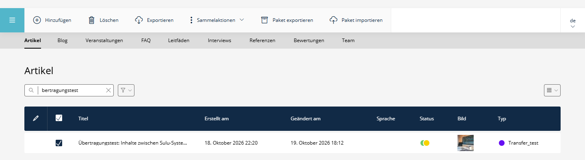
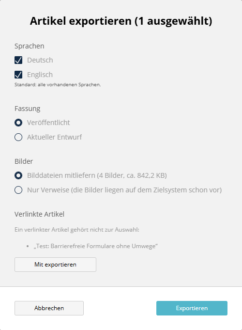
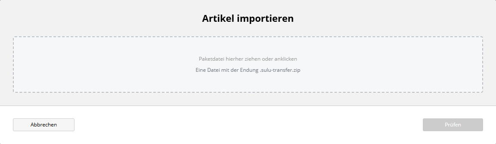
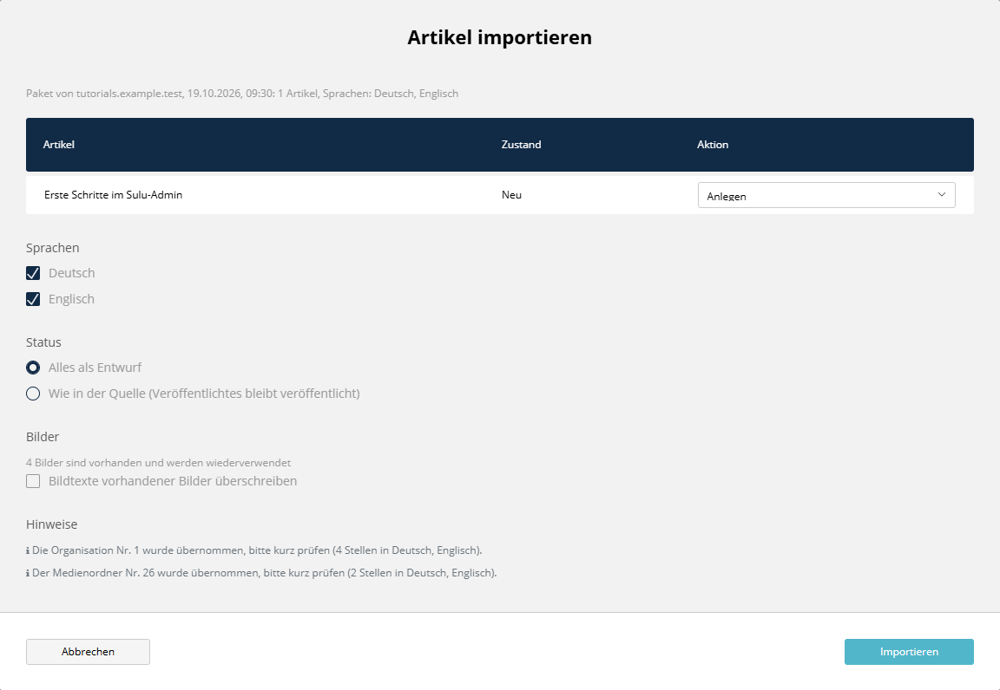
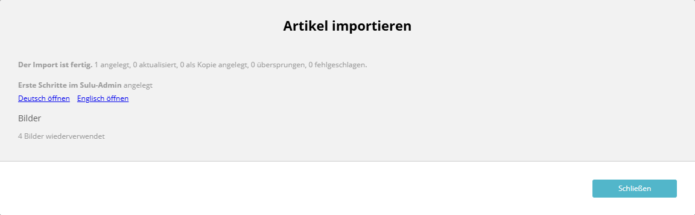

# SuluContentTransferBundle (Sulu 3.x)


[](https://github.com/manuxi/SuluContentTransferBundle/blob/main/LICENSE)


[🇬🇧 English Version](README.md)

Artikel als eine einzige Datei von einem Sulu-System auf ein anderes bringen: lokal schreiben, mit Bildern und Sprachen exportieren, auf dem Live-System importieren. Es geschieht nichts im Verborgenen. Vor dem Schreiben zeigt der Import, was angelegt, aktualisiert oder übersprungen wird, und danach, was er getan hat.



- Export im Admin: Artikel markieren, Sprachen und Fassung wählen, entscheiden, ob die Bilddateien mitgehen, und eine `.sulu-transfer.zip` herunterladen.
- Import im Admin in drei Schritten: Datei wählen, Vorschau prüfen, Bericht lesen. Dasselbe in der Konsole, mit `--dry-run` zum Ansehen ohne Schreiben.
- Artikel behalten ihre UUID. Links bleiben gültig, und ein späterer Import aktualisiert denselben Artikel. Bilder werden über SHA-256 zugeordnet und nicht doppelt angelegt.
- Links auf Seiten, Snippets, andere Artikel, Kategorien, Tags und Kontakte werden auf dem Zielsystem zugeordnet. Was dort fehlt, wird entfernt und im Bericht genannt.
- Standardmäßig wird alles als Entwurf importiert. Das Veröffentlichen entscheidet das Zielsystem.

Version 1 deckt Artikel von Sulu 3 ab, in beide Richtungen zwischen zwei Sulu-3-Systemen. Siehe [Grenzen](#grenzen-von-version-1).

## Installation

```console
composer require manuxi/sulu-content-transfer-bundle
```

1. Bundle in `config/bundles.php` registrieren:
   `Manuxi\SuluContentTransferBundle\SuluContentTransferBundle::class => ['all' => true]`
2. Routen in `config/routes_admin.yaml` einbinden:
   ```yaml
   SuluContentTransferBundle:
       resource: '@SuluContentTransferBundle/Resources/config/routes_admin.yaml'
   ```
3. Das JS in `assets/admin/package.json`
   (`"sulu-content-transfer-bundle": "file:../../vendor/manuxi/sulu-content-transfer-bundle/src/Resources/js"`)
   und `assets/admin/app.js` (`import 'sulu-content-transfer-bundle';`) eintragen und den Admin bauen:
   ```console
   cd assets/admin
   npm install
   npm run build
   ```
   `file:`-Pakete sind Kopien. Nach einem Update des Bundles `node_modules/sulu-content-transfer-bundle` löschen und `npm install` neu ausführen, sonst wird das alte JS gebaut.
4. Die Tabelle `ct_transfer_mapping` anlegen. Sie merkt sich, welcher Artikel dieses Systems zu welchem Artikel eines anderen Systems gehört:
   ```console
   php bin/adminconsole doctrine:migrations:diff
   php bin/adminconsole doctrine:migrations:migrate
   ```
   Die erzeugte Migration prüfen: Sie sollte nur `ct_transfer_mapping` enthalten. Ohne Migrationen lässt sich die Tabelle mit diesem Statement anlegen (MySQL):
   ```sql
   CREATE TABLE ct_transfer_mapping (source_instance VARCHAR(64) NOT NULL, resource_key VARCHAR(64) NOT NULL, source_id VARCHAR(64) NOT NULL, target_id VARCHAR(64) NOT NULL, imported_at DATETIME NOT NULL, source_changed DATETIME DEFAULT NULL, id INT AUTO_INCREMENT NOT NULL, UNIQUE INDEX ct_transfer_mapping_source (source_instance, resource_key, source_id), PRIMARY KEY (id)) DEFAULT CHARACTER SET utf8mb4 COLLATE utf8mb4_unicode_ci
   ```
5. Den Systemordner „Import“ der Medienverwaltung anlegen. Neue Bilder, für die es auf diesem System keinen Ordner mit gleichem Schlüssel gibt, landen dort:
   ```console
   php bin/adminconsole sulu:media:init
   ```
6. Den Cache beider Kernel leeren (`php bin/adminconsole cache:clear`, `php bin/websiteconsole cache:clear`) und den Rollen die Rechte geben (siehe unten).

## Berechtigungen

Das Bundle hat keinen eigenen Sicherheitskontext. Es nutzt die vorhandenen, und der Server prüft jeden Artikel noch einmal:

- Der Export braucht „Ansehen“ für jeden markierten Artikel, im Sicherheitskontext seiner Artikelgruppe (`sulu.article.articles_blog`, ...) und in jeder exportierten Sprache.
- Der Import braucht „Hinzufügen“, um einen Artikel oder eine Kopie anzulegen, und „Bearbeiten“, um einen zu aktualisieren. Beim Aktualisieren zählt auch „Bearbeiten“ in der Gruppe, zu der der Artikel jetzt gehört, nicht nur in der Gruppe der Vorlage aus dem Paket. „Wie in der Quelle“ braucht zusätzlich „Live“ für die Sprachen, die veröffentlicht waren. Für die Vorschau (Schritt 2) genügt „Hinzufügen“ oder „Bearbeiten“ in mindestens einer Gruppe.
- Ein neues Bild braucht „Hinzufügen“ im Ordner, in dem es landet. Eine neue Dateiversion eines vorhandenen Bildes und der Haken „Bildtexte vorhandener Bilder überschreiben“ brauchen „Bearbeiten“ im Ordner dieses Bildes.
- Ein Artikel ohne Berechtigung steht als „Nicht importierbar“ mit dem Grund in der Vorschau. Verlangt jemand ihn ausdrücklich, antwortet der Server mit 403 und schreibt nichts.
- Kategorien und Tags, die es auf dem Zielsystem nicht gibt, legt der Import an, ohne die Berechtigung für Kategorien und Tags gesondert zu prüfen. Die Vorschau nennt sie vorher.

Die Schaltflächen erscheinen nur in Listen, in denen die Person sie benutzen darf.

## Export

In einer Liste einen oder mehrere Artikel markieren und auf **Paket exportieren** klicken:



- Sprachen: nur Sprachen, die die Artikel haben. Standard: alle.
- Fassung: „Veröffentlicht“ nimmt je Sprache die veröffentlichte Fassung, bei einer nicht veröffentlichten Sprache den Entwurf. „Aktueller Entwurf“ nimmt den Entwurf.
- Bilder: „Bilddateien mitliefern“ legt die Originale ins Paket. „Nur Verweise“ lässt sie weg. Das passt, wenn die Bilder auf dem Zielsystem schon liegen.
- Verlinkte Artikel: Artikel, auf die die Auswahl verlinkt, die aber nicht markiert sind, stehen in einer Liste. „Mit exportieren“ nimmt sie dazu.

Heraus kommt eine einzige Datei, zum Beispiel `2026-10-19-erste-schritte.sulu-transfer.zip`. Ein Paket aus dem Admin und eines aus der Konsole enthalten dieselben Artikel und Dateien.

## Import

Auf **Paket importieren** klicken. Schritt 1: Datei wählen.



Schritt 2 ist die Vorschau. Bis hierhin ist nichts geschrieben.



| Zustand | Bedeutung | Standardaktion |
|---|---|---|
| Neu | Den Artikel gibt es hier nicht. | Anlegen |
| Vorhanden, unverändert | Es gibt ihn, und seit dem letzten Import hat ihn niemand geändert. | Aktualisieren |
| Hier geändert am ... | Er wurde nach dem letzten Import auf diesem System geändert. | Überspringen |
| Stammt aus diesem System | Das Paket wurde hier exportiert. | Als Kopie anlegen |
| Nicht importierbar | Die Vorlage fehlt, ein Recht fehlt, oder keine Sprache lässt sich importieren. | Überspringen |

Je Artikel gibt es Anlegen, Aktualisieren, Als Kopie anlegen oder Überspringen. Unter der Tabelle stehen die Sprachen und der Status (alles als Entwurf oder wie in der Quelle). Die Vorschau nennt außerdem, wie viele Bilder schon da sind und wiederverwendet werden, wie viele neu sind und wohin sie kommen, welche Kategorien und Tags neu angelegt werden und welche Links sich nicht zuordnen ließen. Die Regeln der Zuordnung stehen in [Zuordnung](docs/matching.de.md).

Schritt 3 ist der Bericht:



Er listet jeden Artikel mit Links zum Öffnen, die Bilder (neu, wiederverwendet, mit neuer Datei), angelegte Kategorien und Tags, umbenannte Adressen und entfernte Links. Ein Artikel, der scheitert, ist rot. Die anderen laufen weiter.

Ist die Datei größer als die Upload-Grenze des Servers (`upload_max_filesize`, `post_max_size` oder `limits.max_package_size`), sagt der Dialog das und nennt den Konsolenbefehl, mit dem es trotzdem geht.

## Konsole

```console
# einen oder mehrere Artikel exportieren (alle Sprachen, veröffentlichte Fassung, mit Bildern)
php bin/adminconsole sulu:content-transfer:export <uuid> [<uuid> ...] --output=tutorials.sulu-transfer.zip

# nur einige Sprachen, den Entwurf, ohne Bilddateien
php bin/adminconsole sulu:content-transfer:export <uuid> --locale=de --locale=en --stage=draft --no-media-files

# ein Paket ansehen, ohne etwas zu schreiben
php bin/adminconsole sulu:content-transfer:import tutorials.sulu-transfer.zip --dry-run

# importieren; alles wird Entwurf, für jeden Artikel gilt die vorgeschlagene Aktion
php bin/adminconsole sulu:content-transfer:import tutorials.sulu-transfer.zip --user=editor
```

Weitere Optionen des Imports: `--keep-status` (veröffentlichen, was in der Quelle veröffentlicht war), `--overwrite-media-meta` (Texte vorhandener Bilder ersetzen), `--action=<uuid>:create|update|copy|skip` (mehrfach möglich), `--locale=de` (mehrfach möglich), `--json`. `--user` ist der Sulu-Benutzer, der Ersteller und Bearbeiter von allem wird, was geschrieben wird. Die Konsole prüft keine Berechtigungen.

## Konfiguration

```yaml
sulu_content_transfer:
    instance_id: ~              # kennzeichnet dieses System als Quelle von Paketen; Standard: ein Hash von kernel.secret
    instance_label: ~           # lesbarer Name in Paketen und Berichten; Standard: Host der Anfrage, in der Konsole "cli"
    limits:
        max_package_size: 256M  # Größe eines Pakets, für die Datei und für den entpackten Inhalt
        max_files: 2000         # Anzahl der Dateien in einem Paket
    work_dir: '%kernel.project_dir%/var/content-transfer'   # entpackte Pakete und temporäre Dateien
```

`work_dir` darf aus dem Web nicht erreichbar sein, und der Benutzer des Webservers muss dort schreiben können. Entpackte Pakete werden nach dem Import und nach einem Abbruch gelöscht. Was übrig bleibt (ein geschlossener Browser-Tab, ein Absturz), verschwindet nach 24 Stunden beim nächsten Export oder der nächsten Prüfung.

## Betrieb

- **Jedes System braucht ein eigenes `APP_SECRET` oder eine eigene `instance_id`.** Der Import erkennt die Quelle eines Pakets an dieser Kennung und merkt sich die Zuordnung Artikel für Artikel. Wird eine Datenbank kopiert (lokal auf live, live auf Staging), muss die Kennung auf der Kopie trotzdem anders sein. Bei gleicher Kennung hält das System ein fremdes Paket für sein eigenes und bietet nur „Als Kopie anlegen“ an. `instance_id` erlaubt Buchstaben, Ziffern, `.`, `_` und `-`, bis zu 64 Zeichen.
- **Erst den Code deployen, dann die Inhalte importieren.** Ein Artikel braucht seine Vorlage auf dem Zielsystem. Fehlt sie, ist der Artikel „Nicht importierbar“. Vorlagen kommen mit dem Code (`git pull`), Inhalte mit dem Import.
- Als Entwurf importieren, auf dem Ziel veröffentlichen: Der Standard lässt alles Entwurf. Wer einen Artikel aktualisiert, der auf dem Ziel veröffentlicht ist, ändert nur den Entwurf. Die veröffentlichte Fassung bleibt, bis jemand veröffentlicht.
- Große Pakete per SFTP auf den Server legen und in der Konsole importieren.

## Grenzen von Version 1

- Nur Artikel. Seiten und Snippets gehören nicht zu Version 1.
- Sulu 3 nach Sulu 3. Für Sulu 2 sind die Pakete nicht gedacht.
- Der Feldtyp `image_map` (Bild mit Hotspots und Links) wird nicht durchsucht: Verweise darin bleiben, wie sie sind.
- Organisationen, Medienordner und Zielgruppen kann das Paket nicht beschreiben. Sie werden über ihre Nummer zugeordnet, und die Vorschau sagt das.
- Der Export aus dem Browser hält das Paket im Arbeitsspeicher. Große Auswahlen gehören in die Konsole.
- Pakete sind nicht signiert. Wer importieren darf, kann alles importieren, was in der Datei steht, im Rahmen der Berechtigungen oben.

## Format und Zuordnung

- [Austauschformat Version 1](docs/format.de.md): für Werkzeuge, die Pakete lesen oder schreiben
- [Zuordnung](docs/matching.de.md): wie Artikel, Bilder, Links, Kategorien und Tags zugeordnet werden und was bei Konflikten passiert

## Tests

```console
composer install
vendor/bin/phpunit
composer phpstan
composer cs
```
