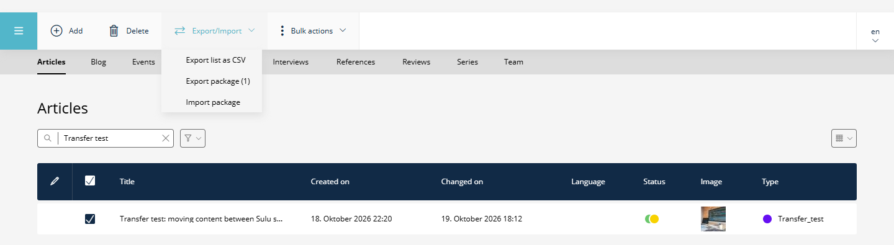
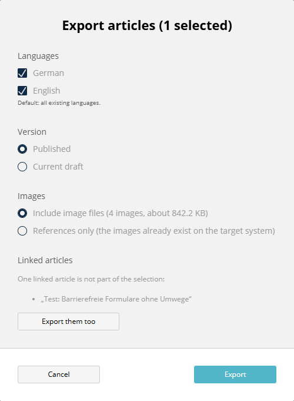
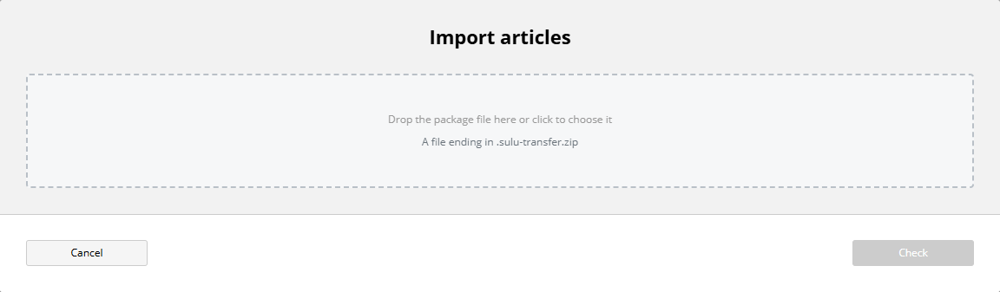
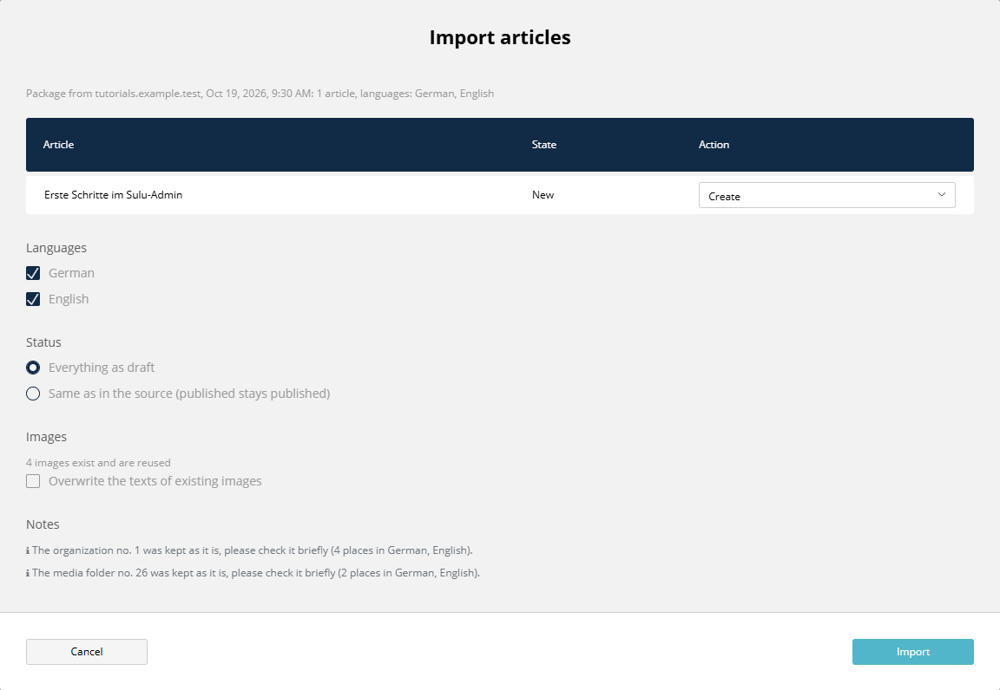
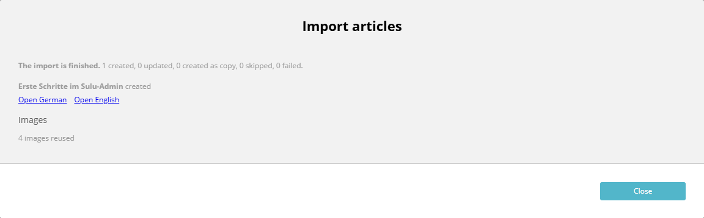

# SuluContentTransferBundle (Sulu 3.x)


[](https://github.com/manuxi/SuluContentTransferBundle/blob/main/LICENSE)


[🇩🇪 German Version](README.de.md)

Move articles from one Sulu system to another as a single file: write them on your local system, export them with their images and languages, import them on the live system. Nothing happens silently: before anything is written, the import shows what will be created, updated or skipped, and afterwards it reports what it did.



- One dropdown **Export/Import** in the article lists. It also holds the CSV export of Sulu, so the toolbar has one entry less to look at.
- Export in the admin: select articles, choose languages, version and whether the image files travel along, download one `.sulu-transfer.zip`.
- Import in the admin in three steps: choose the file, review the preview, read the report. The same on the console, with `--dry-run` for a look without writing.
- Articles keep their UUID, so links stay valid and a later import updates the same article. Images are matched by SHA-256 and are not duplicated.
- Links to pages, snippets, other articles, categories, tags and contacts are matched on the target system. What cannot be found there is removed and named in the report.
- Everything is imported as a draft by default. Publishing stays a decision on the target system.

Version 1 covers articles of Sulu 3, in both directions between two Sulu 3 systems. See [Limits](#limits-of-version-1).

## Installation

```console
composer require manuxi/sulu-content-transfer-bundle
```

1. Register the bundle in `config/bundles.php`:
   `Manuxi\SuluContentTransferBundle\SuluContentTransferBundle::class => ['all' => true]`
2. Import the routes in `config/routes_admin.yaml`:
   ```yaml
   SuluContentTransferBundle:
       resource: '@SuluContentTransferBundle/Resources/config/routes_admin.yaml'
   ```
3. Add the JS to `assets/admin/package.json`
   (`"sulu-content-transfer-bundle": "file:../../vendor/manuxi/sulu-content-transfer-bundle/src/Resources/js"`)
   and `assets/admin/app.js` (`import 'sulu-content-transfer-bundle';`), then build the admin:
   ```console
   cd assets/admin
   npm install
   npm run build
   ```
   `file:` packages are copies. After an update of the bundle delete `node_modules/sulu-content-transfer-bundle` and run `npm install` again, otherwise the old JS is built.
4. Create the table `ct_transfer_mapping` (it remembers which article on this system belongs to which article of another system):
   ```console
   php bin/adminconsole doctrine:migrations:diff
   php bin/adminconsole doctrine:migrations:migrate
   ```
   Check the generated migration: it should only contain `ct_transfer_mapping`. Without migrations the table can be created with this statement (MySQL):
   ```sql
   CREATE TABLE ct_transfer_mapping (source_instance VARCHAR(64) NOT NULL, resource_key VARCHAR(64) NOT NULL, source_id VARCHAR(64) NOT NULL, target_id VARCHAR(64) NOT NULL, imported_at DATETIME NOT NULL, source_changed DATETIME DEFAULT NULL, id INT AUTO_INCREMENT NOT NULL, UNIQUE INDEX ct_transfer_mapping_source (source_instance, resource_key, source_id), PRIMARY KEY (id)) DEFAULT CHARACTER SET utf8mb4 COLLATE utf8mb4_unicode_ci
   ```
5. Create the system folder "Import" of the media library. New images that have no folder of the same key on this system land there:
   ```console
   php bin/adminconsole sulu:media:init
   ```
6. Clear the cache of both kernels (`php bin/adminconsole cache:clear`, `php bin/websiteconsole cache:clear`) and give the roles their permissions (see below).

## Permissions

The bundle has no security context of its own. It uses the ones that already exist, and the server checks every article again:

- **Export** needs "View" for every selected article, in the security context of its article group (`sulu.article.articles_blog`, ...) and in every language that is exported.
- **Import** needs "Add" to create an article or a copy and "Edit" to update one. An update also needs "Edit" in the group the article belongs to now, not only in the group of the template in the package. "Same as in the source" additionally needs "Live" for the languages that were published. The preview of a package (step 2) needs "Add" or "Edit" in at least one group.
- **Images:** a new image needs "Add" in the folder it lands in, a new file version of an existing image and the switch "Overwrite the texts of existing images" need "Edit" in the folder of that image.
- An article without permission is shown as "Not importable" with the reason. If someone asks for it explicitly, the server answers 403 and writes nothing.
- The export checks the articles only. The images and the contact data (name, e-mail address) that the articles refer to travel with them, whatever the permissions for the media library and for contacts say.
- Categories and tags that do not exist on the target system are created by the import without a separate check of the permission for categories and tags. The preview lists them before anything is written.

The entries of the dropdown only appear where the user may use them. Without a permission for any of the package entries, the list keeps the CSV button of Sulu and gets no dropdown.

## Export

Select one or more articles in a list, open the dropdown **Export/Import** and click **Export package**:



- **Languages:** only languages the articles have. Default: all.
- **Version:** "Published" takes the published version of each language, or the draft if a language is not published. "Current draft" takes the draft.
- **Images:** "Include image files" puts the originals into the package. "References only" leaves them out, which is fine if the images already exist on the target system.
- **Linked articles:** articles that the selection links to but that are not selected are listed. "Export them too" adds them.

The download is a single file, for example `2026-10-19-first-steps.sulu-transfer.zip`. A package from the admin and a package from the console hold the same articles and files.

## Import

Open the dropdown **Export/Import** and click **Import package**. Step 1: choose the file.



Step 2 is the preview. Nothing has been written yet.



| State | Meaning | Default action |
|---|---|---|
| New | The article does not exist here. | Create |
| Existing, unchanged | It exists and nobody changed it since the last import. | Update |
| Changed here on ... | It was changed on this system after the last import. | Skip |
| Comes from this system | The package was exported here. | Copy |
| Not importable | The template is missing, the permission is missing, or no language can be imported. | Skip |

Per article you can choose Create, Update, Create as copy or Skip. Below the table you choose the languages and the status (everything as draft, or the same as in the source). The preview also tells how many images exist and are reused, how many are new and where they land, which categories and tags will be created, and which links could not be matched. Details of the matching: [Matching](docs/matching.en.md).

Step 3 is the report:



It lists every article with links to open it, the images (new, reused, with a new file), created categories and tags, renamed addresses and removed links. An article that fails turns red and the others carry on.

If the file is larger than the upload limit of the server (`upload_max_filesize`, `post_max_size` or `limits.max_package_size`), the dialog says so and shows the console command to use instead.

## Console

```console
# export one or more articles (all languages, published version, with images)
php bin/adminconsole sulu:content-transfer:export <uuid> [<uuid> ...] --output=tutorials.sulu-transfer.zip

# only some languages, the draft, without image files
php bin/adminconsole sulu:content-transfer:export <uuid> --locale=de --locale=en --stage=draft --no-media-files

# look at a package without writing anything
php bin/adminconsole sulu:content-transfer:import tutorials.sulu-transfer.zip --dry-run

# import it; everything becomes a draft, the suggested action is used for every article
php bin/adminconsole sulu:content-transfer:import tutorials.sulu-transfer.zip --user=editor
```

More options of the import: `--keep-status` (publish what was published in the source), `--overwrite-media-meta` (replace the texts of existing images), `--action=<uuid>:create|update|copy|skip` (repeatable), `--locale=de` (repeatable), `--json`. `--user` is the Sulu user who becomes creator and changer of everything that is written; the console does not check permissions.

## Toolbar

The dropdown **Export/Import** takes the place of the button "Export" of Sulu in the article lists of every group:

| Entry | Does | Active |
| --- | --- | --- |
| Export list as CSV | opens the CSV dialog of Sulu (same list, same download) | when the list has rows |
| Export package | opens the package export | when articles are selected; shows their number |
| Import package | opens the package import | always |

If a list has no CSV button of Sulu (the user may not view the articles), the dropdown is added at the end of the toolbar and holds the package entries only.

Two options change this, see [Configuration](#configuration): `admin.toolbar: buttons` brings back the two single buttons of version 1.0 and leaves the CSV button of Sulu alone. `admin.merge_csv_export: false` keeps the CSV button where it is; the dropdown then holds the two package entries. The toolbar actions of version 1.0 (`sulu_content_transfer.export` and `sulu_content_transfer.import`) stay registered for projects that add them to their own lists, the dropdown is `sulu_content_transfer.transfer`.

## Configuration

```yaml
sulu_content_transfer:
    instance_id: ~              # identifies this system as the source of packages; default: a hash of kernel.secret
    instance_label: ~           # readable name in packages and reports; default: host of the request, "cli" on the console
    admin:
        toolbar: dropdown       # dropdown: one dropdown "Export/Import"; buttons: two single buttons (as in version 1.0)
        merge_csv_export: true  # only with dropdown: true takes the CSV export of Sulu into the dropdown, false leaves its button
    limits:
        max_package_size: 256M  # size of a package, for the file and for the unpacked content
        max_files: 2000         # number of files in a package
    work_dir: '%kernel.project_dir%/var/content-transfer'   # unpacked packages and temporary files
```

`work_dir` must not be reachable from the web, and the web server's user must be able to write to it. Unpacked packages are removed after the import and after a cancel. What is left over (a closed browser tab, a crash) is removed once it is older than 24 hours, with the next export or analysis.

## Operation

- **Every system needs its own `APP_SECRET` or its own `instance_id`.** The import recognizes the source of a package by this id and remembers the relation article by article. If a database is copied (local to live, live to staging), the id must still differ on the copy. With the same id the system takes a foreign package for its own and only offers "Create as copy". `instance_id` accepts letters, digits, `.`, `_` and `-`, up to 64 characters.
- **Deploy the code first, then import the content.** An article needs its template on the target system. Without it the article is "Not importable". Templates come with the code (`git pull`), content comes with the import.
- **Import as draft, publish on the target.** The default keeps everything as a draft. Updating an article that is published on the target changes the draft only; the published version stays until someone publishes.
- **Large packages** go to the server by SFTP and are imported on the console.

## Limits of version 1

- Only articles. Pages and snippets are not part of version 1.
- Sulu 3 to Sulu 3. Packages are not meant for Sulu 2.
- The field type `image_map` (hotspots with links) is not scanned: references in it stay as they are.
- Organizations, media folders and target groups cannot be described by the package. They are matched by their number; the preview says so.
- The export from the browser holds the package in memory. Large selections belong on the console.
- Packages are not signed. Whoever may import can import whatever is in the file, within the permissions above.

## Format and matching

- [Exchange format version 1](docs/format.en.md): for tools that read or write packages
- [Matching](docs/matching.en.md): how articles, images, links, categories and tags are matched, and what happens on conflicts

## Tests

```console
composer install
vendor/bin/phpunit
composer phpstan
composer cs
```
